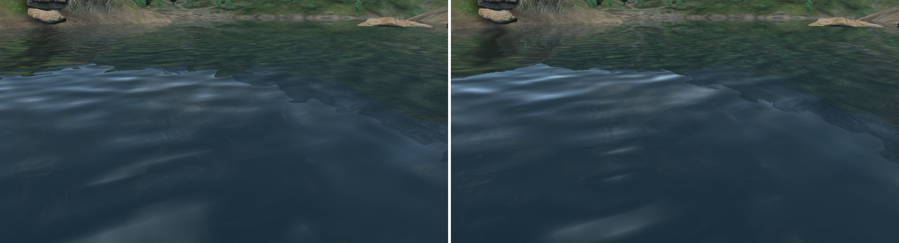

# WaterAA

Calm reflections on distant water for Oblivion (2006). An xOBSE plugin, for
flat screens and VR alike.

*Left: the game's own. Right: with WaterAA (CalmFrom=200). The water around
you is the same; the far shore's reflection holds together.*

## What it fixes

Look across a lake in Oblivion and the reflection of the far shore breaks up
into thin streaks that flicker, even when you stand still. In a headset it
is hard to miss.

The game makes reflections wobble with the waves, and it lets that wobble
grow with the distance - out to 5000 units it stays the same size on your
screen. The waves do not: far off they are smaller than a pixel. So every
pixel row of far water shows the reflection pushed sideways by a different,
random amount, and by another one a moment later.

WaterAA lets the wobble grow as before up to a distance you choose (200 units
by default, about three metres) and holds it there. Beyond that it fades the
way the waves do. Nothing else about the water changes.

## Install

1. You need [xOBSE](https://github.com/llde/xOBSE) 22.10 or newer and
   Oblivion 1.2.416.
2. Copy `WaterAA.dll` and `WaterAA.ini` into `Data\OBSE\Plugins`.

To remove it, delete the two files. It changes nothing on disk and nothing in
your saves.

## Settings

`Data\OBSE\Plugins\WaterAA.ini`, read when the game starts:

| Key | Default | What it does |
|---|---|---|
| `[Main] Enable` | 1 | 0 switches the plugin off. |
| `[Water] CalmFrom` | 200 | From how far away (game units, about 70 to a metre) the wobble stops growing. 100 is calmer still, 600 only a little calmer than the game, 5000 is the game's own. Allowed: 50 to 4999. |

`WaterAA.log` in the game folder says what the plugin did.

## Works with

- **OBVR**, FoliageAA and Oblivion Frame Fixes: tested together.
- Water mods that change textures or settings: not tested yet, but they do
  not touch what WaterAA changes.
- Anything that replaces the game's water shaders (Oblivion Reloaded and its
  forks): WaterAA finds nothing it knows there and leaves the water alone.

Tell me how it looks for you, either way.

## How it was found

Measured on 2026-11-06 at the north shore of Lake Rumare, the head still,
thirty frames in a row. The number is how much a pixel jumps back and forth
from frame to frame (grey levels, 0 to 255; a steady drift does not count).

| | far water | middle | 
|---|---|---|
| the game's own | 3.5 | 2.6 |
| reflections off | 0.7 | 0.6 |
| WaterAA, CalmFrom=600 | 2.6 | 2.6 |
| WaterAA, CalmFrom=200 | 1.4 | 2.1 |
| WaterAA, CalmFrom=100 | 1.1 | 1.6 |

- With the waves' normal map replaced by a flat one the number dropped to
  0.07: all of the flicker comes from the wobble.
- Giving the normal map smaller levels (mipmaps), with and without
  anisotropic filtering, changed nothing (3.5 to 3.2). The wobble is so
  strong that even an averaged normal moves the reflection by many pixels. So
  the plugin does not do that.
- In the water's pixel shaders the shift is `4 + 2496 * saturate(distance *
  0.0002)` world units. WaterAA rewrites those two numbers to `4 + 0.4992 *
  min(distance, CalmFrom)` in a copy of the shader and has the game draw with
  the copy. Of the 10978 shaders in the game's packages exactly four carry
  the pair: WATER000, 001, 007 and 015 (`tools/check-shaders.py`).

## Building

Windows, from a 32-bit Visual Studio prompt:

    cmake -S . -B build -G Ninja -DCMAKE_BUILD_TYPE=Release
    cmake --build build
    ctest --test-dir build

Linux, with clang-cl and a Windows SDK laid out by xwin (see
`cmake/toolchain-linux-clang-cl.cmake`); the device tests run under Wine:

    tools/build-linux.sh

## License

GPL-3.0, see [LICENSE](LICENSE).
